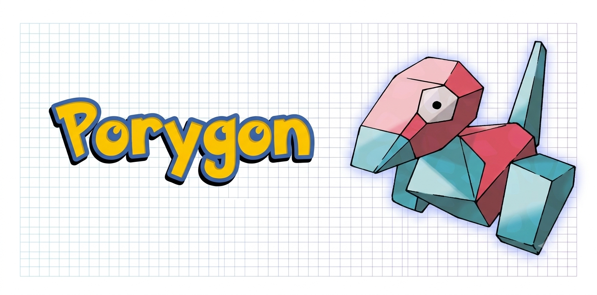

<div align="center">
  
</div>


<b>Porygon</b> is a browser-based workspace for reviewing, arranging, and exporting
shipping-label PDFs. PDF files are processed locally in the browser.

## Workflow

1. Add one or more PDF files and select a source document.
2. Detect candidates. Auto mode keeps each source page intact as a conservative
   starting point so addresses, COD, barcodes/QR codes, and order or product
   details are not removed by an uncertain automatic crop.
3. Select a candidate and drag its crop on the PDF preview. Drag the handles to
   resize it; use the label controls to reorder or remove candidates.
4. Set the output sheet and maximum label dimensions, review the print layout,
   then export print sheets or one label per page.

The default print sheet is A4 portrait with two columns, two rows, and an
18-point margin. Dimensions are PDF points (72 points per inch).

## Development

```sh
npm install
npm run dev
```

Run a production build and lint checks with:

```sh
npm run build
npm run lint
```
